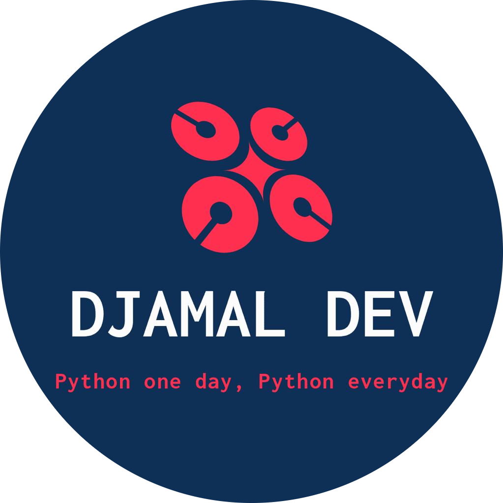

```{=html}
<div class="portfolio-shell">
  <aside class="sidebar" aria-label="Profile sidebar"><div class="sidebar-card"><h1 class="name">Djamal TOE</h1><p class="title">Data Scientist · Biostatistics &amp; Machine Learning Engineer</p><p class="bio">Open to collaborations, technical discussions, and research-oriented projects.</p></div></aside>
  <div class="main-panel">
    <header class="topbar" aria-label="Top navigation"><button class="menu-toggle" id="menuToggle" aria-label="Open navigation drawer" aria-expanded="false"><i class="bi bi-list" aria-hidden="true"></i></button><a class="brand-pill" href="index.qmd" aria-label="Djamal TOE home"></a><nav class="nav-links" aria-label="Primary navigation"><a href="index.qmd">Home</a><a href="experience.qmd">Experience</a><a href="academic-projects.qmd">Academic</a><a href="personal-projects.qmd">Personal Projects</a><a href="skills.qmd">Skills</a><a href="education.qmd">Education</a><a href="blog/index.qmd">Blog</a><a href="about.qmd">About</a></nav></header>
    <main id="main-content">
      <section class="section-card"><div class="section-header"><div><h2 class="section-title">Contact</h2><p class="section-lead">Write to me with the form below, or find me on LinkedIn and GitHub.</p></div></div>
        <div class="contact-card">
          <ul class="contact-list">
            <li><strong>LinkedIn</strong><br /><a href="https://www.linkedin.com/in/djamal-toe-7a18432b0/">Djamal TOE</a></li>
            <li><strong>GitHub</strong><br /><a href="https://github.com/Djamal029/djamal_website">@Djamal029</a></li>
                      </ul>
        </div>
      </section>
      <section class="section-card" id="contact-form">
        <div class="section-header"><div><h2 class="section-title">Send me a message</h2><p class="section-lead">I usually answer within a few days. Your address is only used to reply to you.</p></div></div>
        <form class="contact-form" id="cform" novalidate>
          <div class="cf-row">
            <label>First name<input name="first_name" autocomplete="given-name" required maxlength="80"></label>
            <label>Last name<input name="last_name" autocomplete="family-name" required maxlength="80"></label>
          </div>
          <label>Your email<input name="email" type="email" autocomplete="email" required maxlength="160"></label>
          <label>Subject<input name="subject" required maxlength="160"></label>
          <label>Message<textarea name="message" rows="7" required maxlength="5000"></textarea></label>
          <input type="checkbox" name="botcheck" class="cf-hp" tabindex="-1" autocomplete="off" aria-hidden="true">
          <div class="cf-actions"><button class="btn-primary" type="submit">Send</button><p class="cf-status" id="cfStatus" role="status" aria-live="polite"></p></div>
        </form>
      </section>
    </main>
  </div>
</div>
<div class="drawer-backdrop" id="drawerBackdrop"></div><div class="sidebar-drawer" id="mobileDrawer" aria-label="Mobile navigation drawer"><div class="sidebar-card"><h2 class="name">Djamal TOE</h2><p class="title">Data Scientist · Biostatistics &amp; Machine Learning Engineer</p><h3>Navigate</h3><ul class="contact-list"><li><a href="index.qmd">Home</a></li><li><a href="experience.qmd">Experience</a></li><li><a href="academic-projects.qmd">Academic Projects</a></li><li><a href="personal-projects.qmd">Personal Projects</a></li><li><a href="skills.qmd">Skills</a></li><li><a href="education.qmd">Education</a></li><li><a href="blog/index.qmd">Blog</a></li><li><a href="about.qmd">About</a></li></ul></div></div>
```
<script src="assets/site.js"></script>
<script>
/* Formulaire de contact : envoi via Web3Forms (l'adresse de destination n'apparaît jamais dans le site). */
(function () {
  const KEY = "WEB3FORMS_ACCESS_KEY"; // clé publique fournie par web3forms.com, sans danger dans le code
  const f = document.getElementById("cform"), st = document.getElementById("cfStatus");
  if (!f) return;
  f.addEventListener("submit", async (e) => {
    e.preventDefault();
    if (!f.checkValidity()) { st.textContent = "Please fill in every field with a valid email address."; f.reportValidity(); return; }
    if (KEY.startsWith("WEB3")) { st.textContent = "The form is not active yet. Please use LinkedIn for now."; return; }
    const d = Object.fromEntries(new FormData(f).entries());
    if (d.botcheck) return;
    const btn = f.querySelector("button"); btn.disabled = true; st.textContent = "Sending…";
    try {
      const r = await fetch("https://api.web3forms.com/submit", { method: "POST", headers: { "Content-Type": "application/json", Accept: "application/json" },
        body: JSON.stringify({ access_key: KEY, subject: "[Portfolio] " + d.subject, from_name: d.first_name + " " + d.last_name, name: d.first_name + " " + d.last_name, email: d.email, replyto: d.email, message: d.message }) });
      const j = await r.json();
      if (j.success) { f.reset(); st.textContent = "Thank you, your message has been sent."; } else { st.textContent = "Sending failed. Please try again later or use LinkedIn."; }
    } catch (err) { st.textContent = "Sending failed. Please check your connection or use LinkedIn."; }
    btn.disabled = false;
  });
})();
</script>

